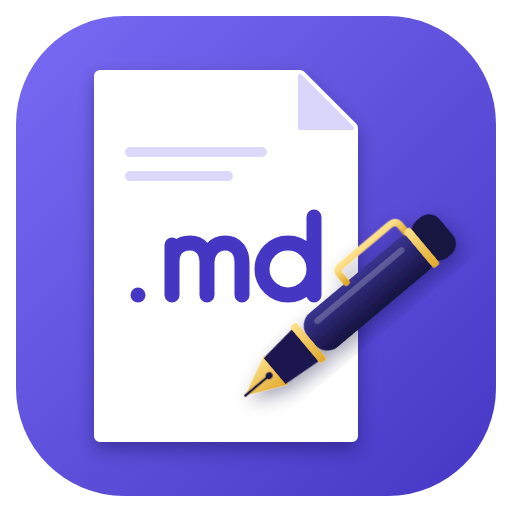

<p align="center"></p>

# PluMd

Editor y visor de ficheros Markdown (`.md`) para Windows, con cinta de opciones tipo Word. Pensado como primer servicio de una plataforma de herramientas internas con arquitectura de plugins.

## Qué hace

- Abre un fichero `.md` suelto (doble clic, botón Abrir o Ctrl+O). No necesita carpeta de trabajo.
- Dos vistas: Lectura (documento limpio y editable, sin símbolos Markdown) y Código (el Markdown tal cual). Ctrl+E alterna.
- Cinta con pestañas Inicio, Insertar y Vista: estilos de título, negrita, cursiva, subrayado, listas, tareas, tablas editables, imágenes, vínculos, bloques de código con resaltado, búsqueda y zoom.
- Varios documentos a la vez en pestañas. Se abren con Abrir, con doble clic o arrastrando los `.md` sobre la ventana.
- Panel de carpetas a la izquierda (Archivo > Abrir carpeta, o arrastrando una carpeta): muestra los `.md`, `.markdown` y `.txt`, se abren en pestaña con un clic y se recuerda la última carpeta. Con el botón derecho: nuevo documento, renombrar, copiar, pegar y borrar. Borrar envía a la Papelera con confirmación y está desactivado en unidades de red; nada se sobrescribe y solo se actúa dentro de la carpeta abierta.
- Los títulos se pueden contraer con la flecha de su izquierda, como en Obsidian.
- Tres aspectos (PluMd, Windows y Mac), cada uno en modo claro y oscuro (Vista > Aspecto). Solo cambian el aspecto, no la distribución. Los skins son hojas CSS con un registro (`src/renderer/skins.js`), pensado para que los futuros plugins añadan los suyos.
- Colores personalizables para títulos, negrita, texto, vínculos y más (Vista > Personalizar colores).
- Cinta de opciones a todo el ancho, con pestañas Inicio, Insertar, Vista y Ayuda.
- No borra ni mueve ficheros. Avisa si el fichero cambió en disco desde que se abrió.

## Desarrollo

Requisitos: Node.js 24 o superior.

```bash
npm install
npm start          # compila y abre la aplicación
npm run dist       # genera el instalador y la versión portable en release/
```

## Estructura

- `src/main/`: proceso principal de Electron (ventana, ficheros, portapapeles).
- `src/renderer/`: interfaz (editor CodeMirror 6, cinta, tablas, imágenes, diálogos).
- `scripts/build.js`: empaquetado del renderer con esbuild.

## Estado

Primera versión de trabajo. Pendiente: API de plugins y conexión MCP para agentes.

## Colaborar

Las propuestas de cambio (Pull Requests) y los avisos de errores (Issues) son bienvenidos. Las normas están en [CONTRIBUTING.md](CONTRIBUTING.md).

## Licencia

[MIT](LICENSE) © 2026 Jorge Ferreira Rey

## Créditos

- La tipografía Inter del aspecto Mac es de The Inter Project Authors, bajo licencia SIL Open Font License 1.1.
- Electron, CodeMirror y Lezer, bajo licencia MIT.
